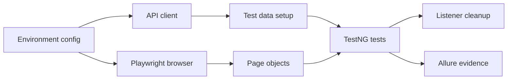

# Playwright Java Healthcare Registry Tests

A Java Playwright/TestNG framework for a private multi-role records and compliance application. The code shows page objects, API setup/cleanup, role-aware sessions, dashboards, imports, exports, and reporting without publishing the application or its data.

Publication approval was obtained for this sanitized portfolio version. Private URLs, credentials, client/company names, internal manuals, screenshots, and real records are excluded.

## What this demonstrates

- Reusable page objects and browser lifecycle management.
- Role-aware authentication and session reuse.
- API calls for test-data setup and cleanup around UI workflows.
- Coverage of records, bulk import/export, dashboards, helpdesk, and compliance flows.
- Allure attachments and centralized cleanup listeners.

## Tech stack

Java, Maven, Playwright, TestNG, Allure, and Logback. Exact versions are taken from `pom.xml`.

## Architecture

```text
src/main/java/com/portfolio/healthcare/qa/
├── api/          API clients for test data
├── auth/         session and authentication state
├── config/       environment and typed configuration
├── driver/       browser lifecycle
├── listeners/    cleanup and reporting hooks
├── models/       roles and data models
└── pages/        reusable page objects and components
src/test/java/com/portfolio/healthcare/qa/
└── tests/        authentication, records, imports, exports, dashboards, and admin flows
```



## Design decisions

Environment values are kept outside the repository. Page objects centralize selectors and waits. API setup/cleanup reduces UI coupling and avoids leaving records behind. Listeners handle cleanup and evidence consistently. The private app is treated as an external dependency rather than bundled into the project.

## Coverage and status

A source scan found 11 test files and 43 `@Test` methods. The coverage areas include authentication, records, bulk import, export, dashboards, helpdesk, labs, legal/compliance, and administrative flows. The tests require a compatible private environment and are not represented as publicly executed results.

## Setup and run

1. Install Java and Maven.
2. Copy `config.properties.example` to a local ignored config file and provide values for a compatible environment.
3. Run `mvn -q -DskipTests compile` for a dependency and source check.
4. Run the TestNG suite only with approved, disposable test data.

Allure results and reports are generated under Maven `target/` and are ignored. No private screenshots or internal manuals are included.

## Limitations and next steps

The application, real data, and internal documentation are unavailable in this portfolio repository. A useful next step would be a small public fixture or contract-test layer that exercises the API and page-object seams without private access.

## AI assistance

The framework was developed with AI assistance. The author is responsible for design, review, sanitization, and execution claims; no claim is made that every line was typed manually.
